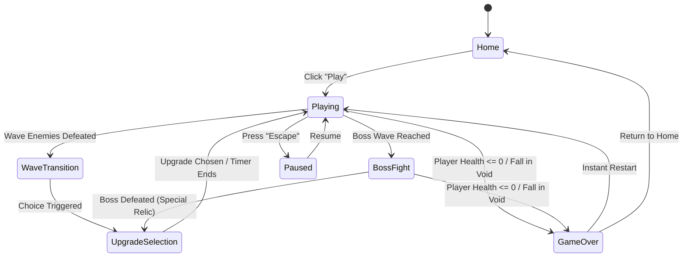
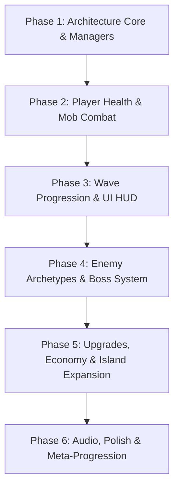

# SKY ADVENTURE – Game Requirements & Technical Specification Document

**Document Version:** 2.0.0  
**Target Engine:** Godot Engine 4.7.1 (GL Compatibility / Jolt Physics 3D)  
**Status:** Requirements Specification & Architecture Blueprint (Non-Destructive Update)  
**Author:** Antigravity AI Systems Design  

---

## 1. Executive Summary & Current Prototype Functionality

### 1.1 Prototype State Analysis
The existing project (`SKY-ADVENTURE`) is a 3D floating-island prototype with core player locomotion, camera control, single-shot projectile shooting, basic bat enemy AI, and an initial UI layer. 

#### Existing Components & Working Features:
- **Player Locomotion & Controls (`player/player.gd`, `Player.tscn`):**
  - First-person / third-person hybrid perspective with free-look mouse camera control (`%Camera3D`).
  - Standard FPS movement (`move_forward`, `move_back`, `move_left`, `move_right`) with normalized 3D velocity (`SPEED = 5.5`).
  - Gravitational physics (`GRAVITY = 20.0`) and grounded jump mechanics (`JUMP_VELOCITY = 10.0`) with variable jump height on key release.
  - Mouse capture toggling on mouse click and unhandled `ui_cancel` (Escape).
  - Ray/marker-based shooting via `%Marker3D` triggering `bullet_3d.tscn` on action `shoot` with a 0.2s cooldown `%Timer`.
  - Gun visual model (`player/simple_gun/gun_model.glb`) attached to the camera with crosshair HUD (`player/reticle.png`).
  - Shooting audio playback (`player/gun_shoot.wav`).
- **Projectile System (`player/bullet_3d.gd`, `player/bullet_3d.tscn`):**
  - `Area3D` projectile moving at `SPEED = 50.0` with maximum range `RANGE = 40.0`.
  - Collision detection with `"mobs"` group calling `play_hurt()`.
- **Enemy System (`mob/Mob.gd`, `mob/mob.tscn`, `mob/bat_model.tscn`):**
  - `RigidBody3D` with locked Y rotation and locked vertical translation during life.
  - Player targeting and horizontal chasing (`speed = 3.0`, `stop_distance = 1.5`).
  - Dynamic orientation (`bat_model.look_at(player)`).
  - Health system (`var health = 3`).
  - Hit response: plays hurt sound (`mob/mob_take_damage.wav`), triggers hurt animation (`"Custom/hurt"` or `"hurt"`).
  - Death sequence: switches gravity to 1.0, applies 3D knockback impulse (`knockback_direction * 5.0 + UP * 2.0`), applies torque impulse, plays KO sound (`mob/mob_ko.wav`), emits `died` signal, and triggers particle poof (`mob/smoke_puff/smoke_puff.tscn`).
- **Mob Spawner (`mob/spawner/mob_spawner_3d.gd`, `mob/spawner/mob_spawner_3d.tscn`):**
  - Randomized timer-based spawning (2.0s to 6.0s intervals).
  - 3D visual spawner pillar with animated shader halo and terminal text.
- **Level & World (`level/temporary_level.tscn`, `level/temporary_level.gd`):**
  - Floating platform islands created with CSGBox3D geometry with checkered triplanar materials (`Platform6`, `Platform7`, `Platform8`, `Platform9`) and linking bridge sequences (`Bridge2`–`Bridge8`).
  - `KillPlane` Area3D reset plane at `Y = -2.06` triggering immediate level reload.
  - Atmosphere setup via `WorldEnvironment` (blue ambient lighting, sky contribution, volumetric fog, directional lighting with shadows).
  - Basic score label on the primary spawner (`LabelSettings_uvm4r`).
- **Initial UI (`level/home_ui.gd`):**
  - `HomeUI` CanvasLayer overlay on game launch with start screen banner ("SKY ADVENTURE: Explore • Survive") and "Play" button. Pauses the engine tree until "Play" is clicked.
  - Inactive `MobileUI` scaffold for virtual joystick and shoot button.

---

## 2. Updated Game Concept: Continuous 3D Sky Adventure Survival

### 2.1 Core Premise
Transform the prototype from a static arena with indefinite, uncoordinated mob spawns into a **Continuous 3D Sky Adventure Survival Game**. 

The player navigates an archipelago of floating sky islands suspended in the clouds. Rather than restarting or returning to an empty lobby after each encounter, the player experiences continuous survival runs:
1. Clearing waves of airborne foes in real time.
2. Earning currency, experience, and immediate tactical upgrades during brief mid-run wave transitions.
3. Unlocking pathways (bridges, jump pads, moving platforms) across previously inaccessible sky islands.
4. Conquering multi-phase sky bosses guarding island anchors.
5. Pushing their build deeper into higher threat levels with persistent progression.

---

## 3. Updated Gameplay Requirements

### 3.1 Continuous Gameplay
- **Unbroken Game Loop:** Once the player presses "Play" from the title/home screen, the session must remain live through consecutive waves and island sectors without resetting to the main menu.
- **Wave Transitions:** Defeating all enemies in a wave initiates a non-disruptive transition phase (3–5 second breather or an Upgrade Selection modal).
- **Gradual Threat Scaling:** Every wave smoothly scales enemy volume, enemy variety, movement speed, attack cadence, and aggression multipliers.
- **Player Survival Loop:** Player health is introduced. Player must survive consecutive waves; health replenishes only via pickups, reward purchases, or post-boss regeneration.
- **Seamless Respawn / Continue:** Death triggers a summary screen with collected coins, score, and unlocked permanent perks before allowing a one-click restart or home return.

### 3.2 Enemy System Expansion
Maintain the current bat model and animations as the baseline mob, expanding into distinctive archetypes:
1. **Standard Bat (Existing Baseline):**
   - Health: 3 HP | Speed: 3.0 | Damage: 10 | Reward: 1 Coin, 10 XP.
   - Behavior: Direct horizontal pursuit, standard stop distance.
2. **Scout Bat / Fast Flying Enemy:**
   - Visual: Scaled down (0.75x), tinted yellow/orange trail or material.
   - Health: 2 HP | Speed: 6.0 | Damage: 5 | Reward: 2 Coins, 15 XP.
   - Behavior: Darting hit-and-run strafing patterns; circles the player.
3. **Armored / Heavy Bat:**
   - Visual: Scaled up (1.4x), steel/bronze shaded material, armored crest.
   - Health: 8 HP | Speed: 2.0 | Damage: 25 | Reward: 5 Coins, 30 XP.
   - Behavior: Unflinching pursuit, high knockback resistance, frontal damage mitigation.
4. **Energy Spitter / Special Flying Enemy:**
   - Visual: Distinct cyan/purple glow shader.
   - Health: 4 HP | Speed: 2.5 | Damage: 15 | Reward: 4 Coins, 25 XP.
   - Behavior: Maintains medium distance (8–12 units), charges and launches telegraphed homing or linear sky-energy projectiles at the player.
5. **Sky Overlord / Boss Enemy:**
   - Visual: Colossal scale (3x), custom crest, crown/halo, dynamic boss health bar HUD.
   - Health: 60–150 HP (scales with sector) | Speed: 3.5 | Damage: 30–40 | Reward: 50 Coins, 500 XP, Island Key / Upgrade Relic.
   - Behavior: Multi-phase attacks (Summon Bat Swarm, Cloud Slam shockwave, Homing Sky Orbs).

### 3.3 Enemy Combat & Damage Delivery
- Enemies must actively deal damage to the player upon entering melee range (`stop_distance`) with a clear attack cooldown (e.g., 1.0s between bites).
- Visual telegraphs: Bat flashes red/winds up before lunging.
- Player feedback: Screen edge red vignette, directional damage indicator, audio flinch sound.

---

## 4. Continuous Gameplay Flow & State Architecture

### 4.1 State Machine Specification
The game state will be governed by a centralized `GameManager` coordinating the following states:



### 4.2 State Details:
1. **Home:** Camera showcases the sky vista; menus allow start, settings, and permanent upgrades.
2. **Playing:** Active wave combat. Real-time enemy tracking, HUD showing current wave, remaining enemy count, player health, ammo/upgrades, and mini-compass.
3. **Wave Transition:** Banner displays "Wave Cleared!". A short 2–3s slowdown or safe window allows players to grab drops.
4. **Upgrade Selection:** Game pauses or enters bullet-time. 3 random upgrade cards are presented (e.g. "+25% Fire Rate", "Multi-Shot +1", "Max HP Up", "Magnet Range").
5. **Boss Fight:** Wave banner announces "WARNING: APEX PREDATOR". Camera pans briefly to boss spawn. Dedicated boss health bar appears at screen top.
6. **Paused:** Invoked via Escape. Shows audio, sensitivity, controls, and resume/quit buttons.
7. **GameOver:** Summarizes survival time, waves conquered, enemies neutralized, coins gathered, and provides "Try Again" or "Main Menu".

---

## 5. Wave & Enemy Progression System

### 5.1 Wave Formula & Spawning Rules
- Spawns occur across designated spawn anchors placed around the perimeter of active islands.
- Spawn pacing prevents overwhelming the player immediately at wave start (enemies spawn in sub-groups or staggered intervals).

#### Wave Scaling Progression Table:
| Wave | Total Mobs | Composition | Spawning Delay | Special Events |
|---|---|---|---|---|
| **1** | 5 | 5 Standard Bats | 2.0s | Tutorial hints, basic combat |
| **2** | 8 | 6 Standard, 2 Fast | 1.8s | First speed challenge |
| **3** | 12 | 8 Standard, 3 Fast, 1 Armored | 1.5s | First high-health mob |
| **4** | 15 | 8 Standard, 4 Fast, 3 Spitters | 1.2s | Projectile dodging introduced |
| **5 (Boss)** | 1 + 6 Minions | **Sky Tyrant Boss** + Bat Swarm | Boss spawns first | **Boss Encounter 1: Unlocks Island 2** |
| **6–9** | 18–28 | Mixed high-density waves | 1.0s | Moving island traversal |
| **10 (Boss)** | 1 + 12 Minions | **Ancient Cloud Wyrm Boss** | Staggered | **Boss Encounter 2: Unlocks Island 3** |

---

## 6. Floating Island & World Progression Requirements

### 6.1 Island Layout & Expansion
The world will transition from the single static CSG layout into a modular, multi-island sky sector system:
1. **Island 1: "The Perch" (Starter Arena):**
   - Repurposes the current platform layout (`Platform6`, `7`, `8`, `9`).
   - Serves as Waves 1–5 combat arena.
   - Contains 2 spawner anchors, health fountain, and exit gate.
2. **Island 2: "The Stepping Pillars" (Agility & Traversal):**
   - Unlocked upon beating Boss 1.
   - Features dynamic moving platforms, vertical jump pads (air geysers), and narrow bridges.
   - Environmental hazard: wind gusts that alter jump trajectories.
3. **Island 3: "The Forgotten Sanctuary" (High Danger Arena):**
   - Unlocked upon beating Boss 2.
   - Tiered circular colosseum with high vantage points for ranged snipers and open air for aerial swarms.
   - Hidden treasure chests requiring parkour to reach.

### 6.2 Traversal Mechanics:
- **Unlockable Bridges:** Retractable energy bridges or floating stone slabs that rise from the cloud bed upon completing specific wave milestones.
- **Air Geysers / Launch Pads:** Upward air jets allowing high leaps to reach elevated islands.
- **Void Recovery / KillPlane Update:** Falling off an island does not immediately end the run if the player has remaining lives/shields; player respawns on the last touched platform with an HP penalty (or instantly ends in hardcore mode).

---

## 7. Weapon, Combat & Reward Upgrade System

### 7.1 Weapon Arsenal & Upgrades
The player's weapon begins as the current single-shot semi-automatic blaster and evolves through upgrades:

| Upgrade Category | Tier 1 | Tier 2 | Tier 3 |
|---|---|---|---|
| **Fire Rate (Rapid Fire)** | Cooldown: 0.16s (-20%) | Cooldown: 0.12s (-40%) | Full Auto Cooldown: 0.08s |
| **Multi-Shot (Spread)** | Twin Shot (2 parallel bullets) | Tri-Shot (15° cone) | Pentashot (5-bullet fan spread) |
| **Heavy Energy Shot** | +30% Bullet Damage, 1.2x size | +70% Damage, Pierces 1 mob | Heavy Plasma: Pierces all, explodes on impact |
| **Bullet Velocity & Range** | +25% Speed (62.5 m/s) | +50% Speed (75.0 m/s) | Instant Hitscan Beam |
| **Mob Magnetism** | Drop attract radius: 4m | Drop attract radius: 8m | Drop attract radius: 15m |

### 7.2 Reward Economy
- **Floating Pickups:**
  - **Sky Coins (Gold Orb):** Spawned from defeated mobs (80% drop chance). Magnetically glide toward the player when within collection radius.
  - **Health Crystals (Heart/Green Orb):** Restores 25% HP (rare drop, 10% chance or purchasable).
  - **Power Surges (Blue Orb):** Temporary 10-second boost (Double Damage or Infinite Rapid Fire).
- **Session Experience (XP):**
  - Fills an on-screen XP bar. Level-ups trigger the Upgrade Selection Screen.
- **Persistent Meta-Progression (Save System):**
  - Banked coins persist across runs via `user://save_data.json` or `ConfigFile`.
  - Upgrades purchasable at the Home Screen: Base HP Boost, Starting Blaster Tier, Starting Coin Bonus, Dash Ability.

---

## 8. System Architecture & Responsibilities

To preserve the existing codebase cleanly without monolithic scripts, new capabilities are divided into dedicated managers following Godot best practices:

```
                      ┌──────────────────────┐
                      │     GameManager      │ (Coordinates overall game state,
                      │      (Autoload)      │  pausing, run stats, scene flow)
                      └──────────┬───────────┘
                                 │
         ┌───────────────────────┼────────────────────────┐
         │                       │                        │
┌────────▼───────────┐ ┌─────────▼──────────┐  ┌──────────▼──────────┐
│    WaveManager     │ │    RewardManager   │  │    IslandManager    │
│ (Spawns, waves,    │ │ (Coins, XP, score, │  │ (Unlocks bridges,   │
│  boss encounters)  │ │  upgrades, saves)  │  │  moving platforms)  │
└────────┬───────────┘ └────────────────────┘  └─────────────────────┘
         │
┌────────▼───────────┐
│   EnemyManager     │
│ (Tracks active     │
│  mobs, archetypes) │
└────────────────────┘
```

### 8.1 System Definitions:
1. **`GameManager` (Node / Autoload):**
   - Tracks current state: `HOME`, `PLAYING`, `WAVE_TRANSITION`, `UPGRADE_SELECT`, `BOSS_FIGHT`, `PAUSED`, `GAME_OVER`.
   - Dispatches state change signals (`game_state_changed(new_state)`).
   - Manages run statistics (time elapsed, total kills, current wave).
2. **`WaveManager` (Node3D):**
   - Holds wave definitions and progression curve.
   - Interfaces with `EnemyManager` to query remaining active enemies.
   - Emits signals: `wave_started(wave_number)`, `wave_completed(wave_number)`, `boss_spawned(boss_node)`.
3. **`EnemyManager` (Node3D):**
   - Replaces the hardcoded spawner timer with a coordinated spawner pool.
   - Maintains a registered list of active mob instances.
   - Instantiates enemy variants from packed scenes (`mob_bat_fast.tscn`, `mob_bat_armored.tscn`, `mob_boss_overlord.tscn`).
   - Listens to mob `died` signals and relays to `RewardManager` and `WaveManager`.
4. **`RewardManager` (Node):**
   - Manages player wallet (`coins`), XP, and level thresholds.
   - Spawns 3D reward pickup scenes (`coin_pickup.tscn`, `health_pickup.tscn`) at mob death coordinates.
   - Handles upgrade selection pools and persists user data to disk.
5. **`IslandManager` (Node3D):**
   - Coordinates island states: locked/unlocked barriers, raising bridges, moving platform tweens.
   - Listens to `boss_defeated` or specific `wave_completed` signals to trigger island reveals.

---

## 9. Preservation & Compatibility Matrix

### 9.1 Existing Assets & Features to Preserve Completely:
- **Player Input Mappings (`project.godot`):**
  - Keep `move_left`, `move_right`, `move_forward`, `move_back`, `jump`, `shoot`.
- **Player Character Core (`player/player.gd`, `Player.tscn`):**
  - Retain the exact physics velocity calculations, mouse sensitivity, camera rotation clamping, and jumping physics.
  - Keep existing nodes (`Camera3D`, `gun_model`, `Marker3D`, `TextureRect`, `Timer`, `AudioStreamPlayer`).
- **Shooting Mechanics & Projectile (`player/bullet_3d.gd`, `player/bullet_3d.tscn`):**
  - Maintain the forward trajectory and collision detection with `"mobs"`.
- **Existing Bat Mob Assets (`mob/bat_model.tscn`, `mob/Mob.gd`):**
  - Preserve the 3D model, animations (`"Idle"`, `"Custom/hurt"`, `"hurt"`), hurt sound, KO sound, and Ragdoll-like knockback torque.
- **Visuals & Atmosphere (`level/temporary_level.tscn`):**
  - Preserve world lighting, triplanar materials, volumetric fog, and existing platform coordinates as Sector 1.
- **Audio Assets:**
  - `gun_shoot.wav`, `mob_take_damage.wav`, `mob_ko.wav`.

---

## 10. Modifications & Additions Delta Matrix

| Component | Current Prototype State | Target Continuous Survival State | Action Required |
|---|---|---|---|
| **Player Health** | Non-existent; invulnerable to mobs | 100 HP bar; damage upon contact or projectiles | **Add** health component & HUD bar |
| **Player Damage Output** | Fixed 1 damage per bullet | Upgradeable (1 → 5 damage, multi-shot, fire rate) | **Modify** `bullet_3d` to take `damage` parameter |
| **Mob Spawner** | Random continuous loop (2–6s) | Managed by `WaveManager`; stops when quota met | **Modify** spawner to spawn on demand |
| **Enemy Varieties** | Single Bat (`health = 3`, `speed = 3.0`) | 5 Archetypes (Standard, Fast, Armored, Spitter, Boss) | **Add** variants extending or inheriting Mob |
| **Mob Attack** | Stops at 1.5m, does no damage | Attacks player on collision or range with cooldown | **Add** attack logic & damage dealing in mob AI |
| **Score System** | Increments on spawner label (double count bug) | Integrated in `RewardManager`; HUD displays Score/Coins/XP | **Refactor** score to dedicated manager & UI |
| **Island Traversal** | Static CSG box layout | Dynamic bridges, moving platforms, unlock gates | **Add** `IslandManager` with tweened platforms |
| **Boss Encounters** | None | Waves 5 & 10 feature Bosses with unique attack routines | **Add** Boss scene, attack scripts, & health bar |
| **UI System** | Basic start screen + Spawner Label | Complete HUD (HP, Wave, Mini-map), Upgrade Modal, Game Over | **Add** modular UI CanvasLayers |
| **Game Persistence** | None; reloads current scene on fall | Saves coins, high scores, unlocked island sectors | **Add** Save/Load manager using JSON |

---

## 11. Development Phases & Implementation Priorities



### Phase 1: Architecture Core & Manager Infrastructure (Priority: HIGH)
- Set up autoload `GameManager.gd` with clean state enums.
- Implement `WaveManager.gd` and `EnemyManager.gd` communication contracts via Godot signals.
- Clean up existing score double-increment connection in `temporary_level.gd`.

### Phase 2: Player Survival & Mob Damage Delivery (Priority: HIGH)
- Add health and damage vulnerability to `Player.gd`.
- Update `Mob.gd` to inflict damage when in `stop_distance` with a damage timer.
- Implement player HUD (Health Bar, Crosshair, Hit Flash Vignette).

### Phase 3: Wave Management & Clean Transitions (Priority: HIGH)
- Wire `WaveManager` to spawn defined waves of enemies.
- Introduce wave counter HUD ("Wave 1 / 10", "Enemies Left: X").
- Add wave victory trigger and transition state.

### Phase 4: Enemy Archetypes & Boss Encounter (Priority: MEDIUM)
- Create inherited scenes or configurable parameters for Fast Bats, Armored Bats, and Spitters.
- Design Boss 1 ("Sky Tyrant") with Boss Health Bar and summon abilities.
- Connect Boss death to wave victory and island key grant.

### Phase 5: Upgrades, Economy & Island Traversal (Priority: MEDIUM)
- Implement `RewardManager` with coin/XP drops and magnetic pull.
- Build 3-card Upgrade Selection screen during wave transitions.
- Build Island 2 & 3 with `IslandManager` unlocking animated bridge slabs upon boss defeat.

### Phase 6: Persistence, Polish & Sound Design (Priority: LOW)
- Implement JSON save/load for high score and coin bank.
- Add background sky adventure music, ambient wind sounds, and upgrade SFX.
- Mobile UI refinement (connecting joystick and shoot button for touch devices).

---
*End of Game Requirements & Specification Document.*
